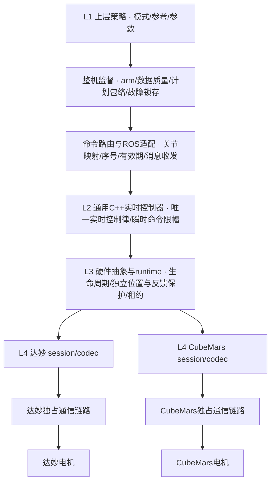
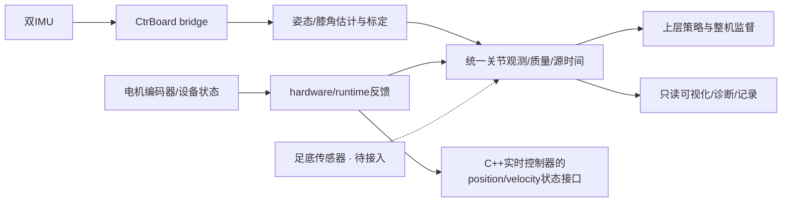

# 代码结构与集成边界

## 目录与职责

仓库包含 11 个 ROS 2 包，依赖边界由 `tools/ci/context_check.py` 校验。
核心和协议是 C++17/ament_cmake；膝角与策略是 Python/ament_python。

| 层 | 包或目录 | 职责与边界 |
|---|---|---|
| 应用策略 | `mech_assist_control` | 整机合同/策略/监督/路由与ROS包装分离；保留单关节入口，默认预览 |
| 通用控制器 | `mech_controllers` | 位置、速度、力矩控制器；边界、斜率、上游目标有效期，不判断电机品牌 |
| 通用硬件接口 | `mech_hardware_ros2_control` | CompositeSystem 与 RuntimePort 契约 |
| 部署组合 | `mech_bringup` | Ak30System、Ak30ServoSystem、Dm4340System、品牌运行时及 URDF/YAML/launch；负责生命周期与物理设备组合 |
| 协议 | `mech_protocol_cubemars`、`mech_protocol_damiao` | 各自的 wire codec、映射和 session；AK3.0 力控/伺服与 DM4340 MIT 的 codec/session；只准备候选命令，不自行拥有串口 |
| 通用传输/运行时 | `mech_control_core` | 原始帧、路由、快照、命令租约、BusRuntime、SocketCAN、USB-CDC 和 POSIX 串口；不认识电机品牌 |
| 传感器协议 | `mech_protocol_ctrboard` | 分片、CRC 和遥测载荷解析 |
| 传感器 ROS 接入 | `mech_ctrboard_bridge` | 只接收桥、标准消息与诊断；不发布电机目标 |
| 膝角/观察 | `mech_knee_kinematics` | 纯估计核心、ROS 标定节点、面板、影子策略和离线模型 |
| 模拟与故障注入 | `mech_simulation` | 虚拟时钟、FakeTransport 与确定性故障路径 |
| 操作/验证工具 | `tools/bench`、`tools/validation` | 有界台架脚本与合成 ROS 图检查；不由默认构建自动执行实机操作 |

## 整机应用入口

[EXO-ARCH-001整机控制框架](exoskeleton_control_architecture.md)是当前应用层实施入口。
`mech_assist_control/robot/`按合同、策略、监督、路由分文件；`robot_node.py`适配ROS。
默认 `exoskeleton_preview.launch.py`不启动串口桥或电机manager。
已配置的关节经统一状态进入策略，命令需经新鲜度、标定、包络和输出路由检查。
策略不判断电机品牌；底层厂商适配保持并列，机械映射和支持接口必须显式配置。
原有单关节/桌面入口保留用于历史复现，不充当整机调度器。

## 自上而下的控制层级

上层策略位于最上层；传感器是闭环反馈支路，不是位于策略之上的调度层。
依赖、控制命令下发和传感器数据流分别描述，避免按数据到达顺序误读层级。



## 独立感知与反馈支路



传感器独立验证与离体电机试验不能合并为穿戴通过。
固定位置训练目前使用编码器；IMU到训练电机的联合闭环尚未验收。

## 上层内部的单一职责

| 模块 | 输入与输出 | 约束 |
|---|---|---|
| `robot/policies.py` | `RobotObservation` → `PolicyTarget(training_plan=ImpedancePlan)` | arm时捕获固定参考，持有不可变参考/K/D/cap；不计算该模式的PD |
| `robot/supervisor.py` | 策略计划 → `CommandEnvelope` | 检查质量、位置/参数范围、时长及计划一致性；异常锁存，不把计划当作力矩向量限斜率 |
| `robot/routing.py` | 有效信封 → 完整逐轴计划 | 全轴校验后才返回；拒绝过期/重放、超上限、未经支持的映射和标量出口绕过 |
| `robot_node.py` | ROS消息/参数/服务 ↔ 纯逻辑模块 | 组合配置、源时间适配、序列化与发布；不另存参考或重算控制律 |

`ImpedancePlan`与`CommandEnvelope`为不可变数据合同。正常指令保留信封原始产生时间，
不会在ROS发布时重置年龄。所有轴校验通过才开始发布，但多话题仍非跨轴原子事务。
旧Python阻尼/助力/保持算法仅为离线预览参考；统一motor出口只接受结构化C++固定位置阻抗。

## 电机代码的组织

- `mech_control_core/posix_cdc_serial_port.*` 是串口实现的唯一来源；
  bringup 旧头保留类型别名，避免探针调用入口重复实现。
- 每个物理串口由一个插件拥有。串口在配置和清空缓冲前取得非阻塞 advisory flock，
  防止框架内两个进程争用；外部程序必须配合锁约定，锁不取代物理总线调度。
- `seven_channel_gateway.hpp` 统一电机网关参数构造，位速率未知时保持未知。
- `Dm4340System` 在启动时固定 position、velocity 或 effort，每个接口都与
  `command_generation` 整组申领/释放；同一网关最多六个达妙关节共享一条运行时。
- `dm4340_runtime.*` 统一承载 position、velocity 与 effort，旧 velocity 头仅保留类型别名；配置中的
  `Dm4340CommandMode` 决定模式，不同时暴露两种写入口。
- CubeMars 和达妙用同一启动入口互斥选择，不能同时打开同一串口，也尚不支持
  在一个网关内混合两种品牌的运行时。

串口部分写入后发生背压会返回 Fault，避免上层重试整帧而重复前缀。
相关回归使用 Linux 伪终端，不接触真实设备。

## 运行入口与默认行为

| 用途 | 入口 | 默认行为 |
|---|---|---|
| 传感器接收 | `mech_ctrboard_bridge/ctrboard_usb_cdc.launch.py` | 打开指定传感器串口、转发遥测，无运动帧 |
| 膝角估计 | `knee_kinematics_node` | 只读 IMU，未标定不输出有效膝角 |
| 整机应用 | `exoskeleton_control_node` | 上层策略/计划/监督；默认preview，不启用硬件 |
| 历史单膝工具 | `knee_control_node` | 速度跟随/阻力预览，不作为整机主入口 |
| 电机组合 | `motor_backend_bringup.launch.py` | 必须选 backend/device，达妙硬件和控制器保持 inactive |
| 合成图验证 | `tools/validation/check_*_ros_graph.py` | 合成输入，无实机电机启动 |

速度模式使用 `VelocityCommandController` 和可配置 MIT Kd/前馈；
力矩模式使用 `EffortCommandController`，MIT Kp/Kd 为零。
速度模式中的前馈力矩不构成独立力矩模式验收。
`supervised_effort_bench` 是仅限单离体轴、身份映射、最大 0.1 Nm 的特殊配置，
不允许借此绕过速度模式闸门。阻力策略的预览或软件测试不代表人体训练验证。

## 验证与状态索引

```bash
python3 tools/ci/context_check.py
python3 tools/ci/check_adrs.py
source /opt/ros/humble/setup.bash
MECH_SKIP_ROSDEP=1 MECH_OUTPUT_ROOT=/tmp/mech-validation \
  bash tools/ci/build_workspace.sh
```

只有主机依赖已经配置时才使用 `MECH_SKIP_ROSDEP=1`；正式 CI 保留依赖解析。
全量 build/test 包含 Python 包测试，硬件探针默认不构建。
带真实 ROS 图的合成检查另在加载当前构建后运行，具体结果见 PR。

合成图验证可统一执行：

```bash
bash tools/validation/run_sensor_ros_checks.sh /tmp/mech-validation/install/setup.bash
```

该入口自动启动合成输入需要的膝角节点，顺序检查五张 ROS 图并清理进程；
不启动传感器串口桥或电机硬件。直接执行 `check_knee_ros_graph.py` 则要求
调用方预先启动同参数的膝角节点。

- [当前规划](../planning/README.md)：共享阶段与未决项。
- [架构决定](../adr/README.md)：规范边界；ADR-021 保持 Proposed。
- [10 月 16 日历史验证](../validation/2026-10-16-exoskeleton-architecture.md)：双 IMU/影子图、历史联合构建与电机试验。
- [10 月 20 日速度复测](../validation/2026-10-20-dm4340-speed-retest.md)：既有隔离构建的空载速度结果。

压力话题字段存在不证明鞋垫已接入；完整传感器驱动电机闭环、关节映射计量、
断联保护及穿戴负载均不能由离线测试推定通过。

历史原生位置阻抗仍保留MIT模式：通用PositionCommandController发送限斜率位置目标，
厂商适配层编码Kp/Kd，由电机内部计算弹簧与阻尼。历史试验性ImpedanceCommandController已移除；当前规范FixedPositionImpedanceController是后续独立实现，不复用该旧插件。

## 可选抗阻快环

新增通用 `ResistanceTrainingController`：借用位置/速度状态，在500 Hz目标更新周期计算有界反向力矩；
Python只发送50 Hz许可。原有应用抗阻路径保留，快环需显式选择。
参数、`resistance_training_fast`入口、许可TTL与下层保护边界见[抗阻快环说明](resistance_fast_loop.md)。
软件及无设备回环已验证，新路径实机阻力与抖动尚未验收。

### 当前控制权边界

统一上层的固定位置阻抗通过 `training_command` 一帧给出参考/K/D/cap/许可；
`mech_controllers` 独占实时控制律，hardware/runtime独立执行最终保护。
Python策略中的反馈计算仅作离线参考，统一节点拒绝其motor输出。
字段和迁移限制见[训练指令合同](training_command_contract.md)。
