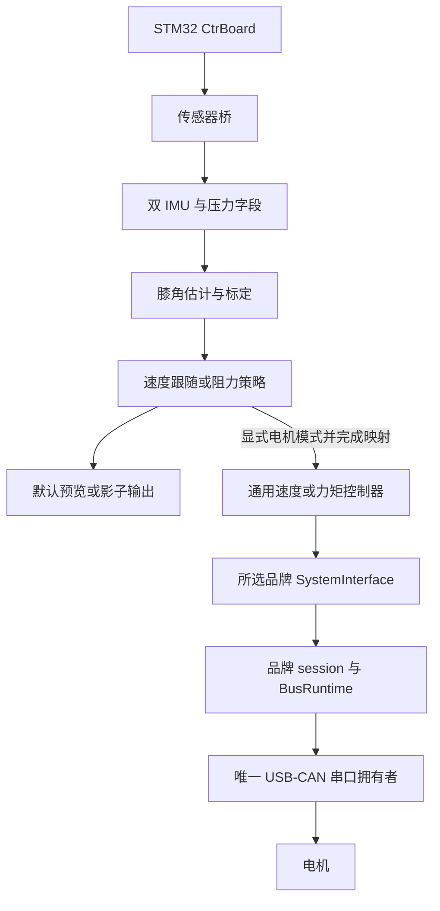

# 代码结构与集成边界

## 目录与职责

仓库包含 11 个 ROS 2 包，依赖边界由 `tools/ci/context_check.py` 校验。
核心和协议是 C++17/ament_cmake；膝角与策略是 Python/ament_python。

| 层 | 包或目录 | 职责与边界 |
|---|---|---|
| 通用传输/运行时 | `mech_control_core` | 原始帧、路由、快照、命令租约、BusRuntime、SocketCAN、USB-CDC 和 POSIX 串口；不认识电机品牌 |
| 协议 | `mech_protocol_cubemars`、`mech_protocol_damiao` | 各自的 wire codec、映射和 session；AK3.0 力控/伺服与 DM4340 MIT 的 codec/session；只准备候选命令，不自行拥有串口 |
| 传感器协议 | `mech_protocol_ctrboard` | 分片、CRC 和遥测载荷解析 |
| 通用硬件接口 | `mech_hardware_ros2_control` | CompositeSystem 与 RuntimePort 契约 |
| 通用控制器 | `mech_controllers` | 位置、速度、力矩控制器；边界、斜率、上游目标有效期，不判断电机品牌 |
| 部署组合 | `mech_bringup` | Ak30System、Ak30ServoSystem、Dm4340System、品牌运行时及 URDF/YAML/launch；负责生命周期与物理设备组合 |
| 传感器 ROS 接入 | `mech_ctrboard_bridge` | 只接收桥、标准消息与诊断；不发布电机目标 |
| 膝角/观察 | `mech_knee_kinematics` | 纯估计核心、ROS 标定节点、面板、影子策略和离线模型 |
| 应用策略 | `mech_assist_control` | 纯策略与 ROS 包装分离；速度跟随或阻力，默认预览 |
| 模拟与故障注入 | `mech_simulation` | 虚拟时钟、FakeTransport 与确定性故障路径 |
| 操作/验证工具 | `tools/bench`、`tools/validation` | 有界台架脚本与合成 ROS 图检查；不由默认构建自动执行实机操作 |

## 两条独立数据流



图表示代码可组合路径，不表示真实传感器到电机的完整闭环已验收。
传感器独立验证与离体电机试验不能合并为穿戴通过。

## 电机代码的组织

- `mech_control_core/posix_cdc_serial_port.*` 是串口实现的唯一来源；
  bringup 旧头保留类型别名，避免探针调用入口重复实现。
- 每个物理串口由一个插件拥有。串口在配置和清空缓冲前取得非阻塞 advisory flock，
  防止框架内两个进程争用；外部程序必须配合锁约定，锁不取代物理总线调度。
- `seven_channel_gateway.hpp` 统一电机网关参数构造，位速率未知时保持未知。
- `Dm4340System` 在启动时固定 velocity 或 effort，每个接口都与
  `command_generation` 整组申领/释放；同一网关最多六个达妙关节共享一条运行时。
- `dm4340_runtime.*` 统一承载 velocity 与 effort，旧 velocity 头仅保留类型别名；配置中的
  `Dm4340CommandMode` 决定模式，不同时暴露两种写入口。
- CubeMars 和达妙用同一启动入口互斥选择，不能同时打开同一串口，也尚不支持
  在一个网关内混合两种品牌的运行时。

串口部分写入后发生背压会返回 Fault，避免上层重试整帧而重复前缀。
相关回归使用 Linux 伪终端，不接触真实设备。

## 运行入口与默认行为

| 用途 | 入口 | 默认行为 |
|---|---|---|
| 传感器接收 | `mech_ctrboard_bridge/ctrboard_usb_cdc.launch.py` | 打开指定传感器串口、转发遥测，无运动帧 |
| 膝角估计 | `knee_kinematics_node` | 只读 IMU，未标定不输出有效膝角 |
| 应用控制 | `knee_control_node` | 速度跟随预览；`control_strategy:=resistance` 选择阻力 |
| 电机组合 | `motor_backend_bringup.launch.py` | 必须选 backend/device，达妙硬件和控制器保持 inactive |
| 合成图验证 | `tools/validation/check_*_ros_graph.py` | 合成输入，无实机电机启动 |

速度模式使用 `VelocityCommandController` 和可配置 MIT Kd/前馈；
力矩模式使用 `EffortCommandController`，MIT Kp/Kd 为零。
速度模式中的前馈力矩不构成独立力矩模式验收。
`supervised_effort_bench` 是仅限单离体轴、身份映射、最大 0.1 Nm 的特殊配置，
不允许借此绕过速度模式闸门。阻力策略的预览或软件测试不代表人体训练验证。

## 验证与状态索引

```bash
python3 tools/ci/context_check.py
python3 tools/ci/check_adrs.py
source /opt/ros/humble/setup.bash
MECH_SKIP_ROSDEP=1 MECH_OUTPUT_ROOT=/tmp/mech-validation \
  bash tools/ci/build_workspace.sh
```

只有主机依赖已经配置时才使用 `MECH_SKIP_ROSDEP=1`；正式 CI 保留依赖解析。
全量 build/test 包含 Python 包测试，硬件探针默认不构建。
带真实 ROS 图的合成检查另在加载当前构建后运行，具体结果见 PR。

- [当前规划](../planning/README.md)：共享阶段与未决项。
- [架构决定](../adr/README.md)：规范边界；ADR-021 保持 Proposed。
- [10 月 16 日历史验证](../validation/2026-10-16-exoskeleton-architecture.md)：双 IMU/影子图、历史联合构建与电机试验。
- [10 月 20 日速度复测](../validation/2026-10-20-dm4340-speed-retest.md)：既有隔离构建的空载速度结果。

压力话题字段存在不证明鞋垫已接入；完整传感器驱动电机闭环、关节映射计量、
断联保护及穿戴负载均不能由离线测试推定通过。
