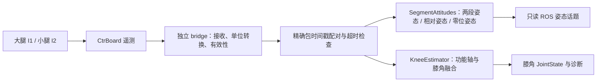

# IMU-ATT-001：Jetson 双 IMU 实时姿态与膝角

## 范围与参考

用户提供的 `DualIMU_Knee_App.zip` 为本轮参考；原始压缩包不进入仓库。
SHA-256：`9a0a3e96308dc22d9cebae681d2915005a651f35b26645a563759a5fbebe5af7`。
其中 `dual_imu_knee.py` 的 SHA-256 为
`0b39fe8a74893f3d3cea223f0833d746583152dac5c4f99349d6ebc3181c25d0`。
对比当前版本，纯核心仅增加 `hipnuc_vector_to_standard`，算法主体相同。
本轮复用核心，补齐无界面 Jetson 姿态输出，不复制 Windows 串口界面与本机标定文件。
附件提到的 `DATA_RELIABILITY_VALIDATION.md` 不在压缩包内，其误差结论未核实。

这里的“姿态解算”以传感器固件已解出的原生四元数为观测，Jetson 做坐标变换、
两段姿态、零位相对姿态及膝角融合；不是由原始加速度/陀螺仪重新实现 AHRS，
也不是全身运动捕捉。没有磁场数据、独立姿态基准或硬件采样时间证据时，
不宣称消除了绝对航向漂移、两 IMU 航向偏差或实现了解剖学角度计量。

## 数据与模块边界



- 复用 `mech_protocol_ctrboard`、`mech_ctrboard_bridge`，串口仍由 bridge 单独持有。
- `mech_knee_kinematics/attitude.py` 是无 ROS 的确定性姿态计算核心。
- 现有 `node.py` 完成配对、标定服务与消息封装；没有电机目标发布或控制器调用。
- 回调随有效配对事件发布，不用高频定时器重复旧姿态。吞吐取决于输入与 Jetson 调度；
  Python/rclpy 的软件验证不构成硬实时保证。

## 坐标、单位与话题

默认保留上位机的 HiPNUC 映射：四元数 `wxyz -> (w,y,x,-z)`，
机体系向量 `(x,y,z) -> (y,x,-z)`。桥接层已将角速度转为 rad/s，
膝角核心入口再转 deg/s；姿态核心内部四元数为 wxyz，ROS 消息字段为 xyzw。
四元数在使用前归一化；不得对已标准化输入重复映射，此时用 `basis_mapping=identity`。

| 输出 | 消息 | 含义与参考系 |
|---|---|---|
| `attitude/thigh/orientation` | QuaternionStamped | 大腿 IMU 姿态，`imu_reference` |
| `attitude/shank/orientation` | QuaternionStamped | 小腿 IMU 姿态，`imu_reference` |
| `attitude/relative/orientation` | QuaternionStamped | `conj(q_thigh) * q_shank`，大腿 IMU 系 |
| `attitude/{thigh,shank}_from_zero/orientation` | QuaternionStamped | 每段 `conj(q_zero) * q_current`，各自站立零位系 |
| `attitude/{thigh,shank}/rpy_rad` | Vector3Stamped | x/y/z 为 roll/pitch/yaw，ZYX 约定，rad，仅显示 |
| `knee/joint_state` | JointState | 已标定膝屈伸角 rad、角速度 rad/s |
| `knee/flexion_deg` | Float64 | 兼容现有显示的膝角 deg |
| `knee/diagnostics` | DiagnosticArray | 配对、超时、标定与膝角质量，含累计姿态对数 |

`imu_reference` 只是设备四元数的参考约定，不是经过验证的地理 ENU。
同一参考名称不证明两颗 IMU 航向已对齐；相对姿态沿用上位机的共同参考假设。
各段姿态是经校验的设备观测，不采用膝角滤波后的结果，姿态跳变须结合诊断判断。
Euler 在 pitch ±90° 存在固有奇异性；后续算法应消费四元数与有效性诊断。
没有发布 TF，也不把 IMU 安装系直接命名为人体解剖坐标系。

两路完整有效数据到达即输出姿态；零位姿态必须先完成静态标定。
膝角必须按“静态零位 → 动作轴 → 再次静态零位”完成流程。
动作轴成功后主动清除旧零位，避免只提示重新站立却继续输出旧基准膝角。
标定期间姿态和膝角均停发；标定只保存在内存，重启或重新安装必须重做。

## 时间与异常处理

桥接器给同一个包的两个 IMU 相同 ROS 时间戳，节点精确匹配，不拼接不同包。
膝角积分使用配对包的 header 时间，单调时钟只用于接收延迟、超时和标定时窗。
这可去除节点回调积压引入的积分时间误差，但不能消除 USB 接收抖动。
它仍不是 IMU 硬件采样时刻，也无法检测包持续更新时某颗 IMU 内部数据冻结。

- 缺失时间戳、非法四元数/向量、缺失协方差标志、配对延迟、乱序和整对超时沿用现有检查。
- 启动配置的配对延迟 60 ms、整对超时 300 ms 与参考上位机一致；旧节点默认值保留兼容。
- 无效对不发布姿态或膝角，不补发旧值；打断配对会重置膝角滤波，标定采集中断需重启。
- 单独订阅姿态时，消费者必须检查消息时间与诊断；话题静默不是自动生成的安全停止指令。

## 启动与验收

先构建并 source 对应工作区。已有 bridge 的输入话题就绪后：

```bash
ros2 launch mech_knee_kinematics dual_imu_attitude.launch.py
ros2 topic echo /attitude/thigh/orientation
ros2 topic echo /attitude/shank/orientation
ros2 service call /knee/start_static_calibration std_srvs/srv/Trigger '{}'
# 保持站直静止，等待静态标定完成后：
ros2 service call /knee/start_axis_calibration std_srvs/srv/Trigger '{}'
# 屈伸完成、节点提示后，回到站直姿态：
ros2 service call /knee/start_static_calibration std_srvs/srv/Trigger '{}'
```

launch 只启动接收节点，不打开设备或启动 bridge。真实数据采集需单独确认端口、
独占性与现场状态，本轮不进行真实设备操作。

软件验收：解析几何姿态、两段共同运动、四元数正负等价、Euler 奇异点、零位生命周期；
节点无标定姿态输出、无效对停发、按包时间积分；Jetson 原生构建和合成 ROS 图；
100 Hz 合成发布下的接收比例和端到端延迟（含 DDS 和验证订阅器，不是纯算法耗时）。
参考核心原有 13 项测试也对当前包内核心执行。

下一阶段：真实双 IMU 只读录制，与独立角度参考同步对比，分别报告站立漂移、
静态多角度误差、动态误差/延迟和重装标定一致性。未完成这些工作前，不称实机姿态精度已验收。

### 2026-10-20 本地软件结果

在本次 Jetson Ubuntu / ROS 2 Humble 环境，基于 `f099efd` 的本地开发改动：

| 检查 | 观察结果 |
|---|---|
| Python 包测试 | 44 项通过 |
| 附件原有核心测试，对当前核心运行 | 13 项通过 |
| 原生 colcon 单包构建 | 通过，安装姿态核心、配置及 launch |
| 安装后 launch | 收到节点诊断，单次父进程 SIGINT 后子节点正常退出 |
| 合成 ROS 图 | 膝角/姿态、shadow、gait shadow、架构联合四图通过，无电机目标发布 |
| 100 Hz 合成输入，5 秒 | 500 对发送 / 500 对姿态接收 |
| 本次端到端延迟 | P95 3.538 ms，最大 4.454 ms；不代表最坏时限保证 |
| 上下文、文档链接、脚本语法、diff 空白检查 | 通过 |

上述均为软件及合成输入结果；真实设备采集、传感器精度测量和电机操作未运行。

## 实时可视化

新增 `dual_imu_attitude_viewer`，独立订阅姿态节点的输出，不打开串口、不发布电机目标，
也不调用标定服务。需要 Jetson 图形桌面和 Tk（项目已有 `python3-tk` 依赖）。

```bash
# 构建并 source 本地工作区后，先启动解算节点并完成标定：
ros2 launch mech_knee_kinematics dual_imu_attitude.launch.py
# 在另一个已 source 的终端打开实时界面：
ros2 run mech_knee_kinematics dual_imu_attitude_viewer
# 独立查看合成动画，无 ROS 初始化、无设备访问：
ros2 run mech_knee_kinematics dual_imu_attitude_viewer --demo
```

界面包括大腿/小腿独立运动的 X–Z、Y–Z 二维投影，膝角、角速度、两段 RPY，
以及最近 20 秒曲线。动画使用各段站立零位相对四元数旋转单位段方向，不将大腿固定。
它是传感器姿态投影，不是人体解剖模型；画面长度为示意长度。

两段姿态必须有相同包时间戳、接收时间在 300 ms 内；膝角也须新鲜，
且最近 500 ms 内的膝角诊断为 OK，才显示为有效。标定、断流、缺失或告警时
姿态变灰、实时数值显示“—”，历史曲线保留，不填充失效时段。
窗口重绘不重复添加同一关节样本；历史缓存有上限。合成模式始终标明“非真实设备”。

GUI 与 ROS 回调在同一线程有界处理，每帧最多处理 32 次回调，约 30 Hz 重绘；
窗口关闭会销毁订阅节点。显示器本身不是控制安全监视器。
没有桌面的环境可运行纯状态测试，不能把它当成真实窗口渲染验证。

显示与订阅回归（隔离 ROS 域、仅合成发布）：

```bash
ROS_DOMAIN_ID=67 ROS_LOCALHOST_ONLY=1 python3 tools/validation/check_attitude_viewer.py
```

2026-10-20 本机完成 48 项包测试、图形桌面合成动画渲染和预览截图；
真实 ROS 消息订阅窗口的正常显示、停流失效、恢复与关闭均通过合成 ROS 回归，
结果记录在本地测试日志；没有连接真实 IMU。

### 桌面真实传感器模式

两颗传感器未安装到大腿/小腿时使用：

```bash
ros2 run mech_knee_kinematics dual_imu_attitude_viewer --raw
```

该模式订阅 `attitude/{thigh,shank}/orientation` 和桥接器的传感器有效性诊断，
将两颗传感器独立显示为 I1/I2，不把它们连接成人腿，不要求人体标定。
曲线显示两颗 IMU 的 Pitch，膝角和角速度保持未标定/空值。
这里的话题名仍与既有 I1/I2 管线兼容，不能据此认定当前安装在人腿上。

可视化缓存收到同包两路四元数后原子更新；只收到一路时保留上一完整数据对，
沿用其原始接收时间判断 300 ms 超时，不能用新到的一路续期旧数据。
最多保留 8 个待配对包。这样既不会混用两个时间戳，也避免回调先后到达造成误闪灰。

真实双 IMU 桌面只读链路已验证，见[现场显示验证](../validation/2026-10-20-dual-imu-live-view.md)。
