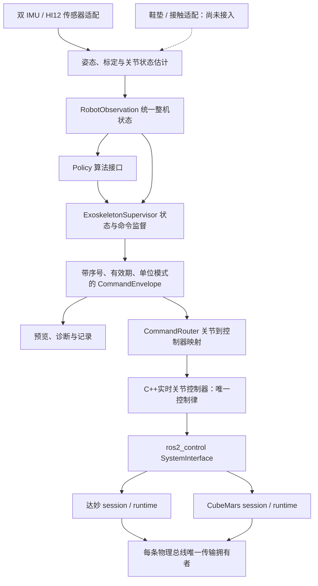
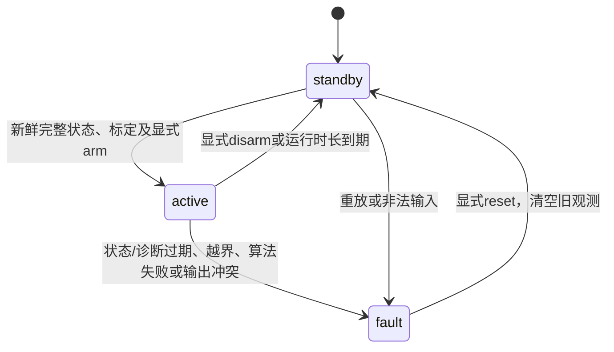

# EXO-ARCH-001：整套外骨骼控制架构

## 当前确认的执行边界（2026-10-23）

**上层选模式、给目标和参数；C++控制器唯一负责实时控制律；底层执行独立保护。**
固定位置阻抗规范入口已按[结构化训练指令合同](training_command_contract.md)实现：
上层arm捕获参考并发送K/D/cap，C++每周期计算PD。
其他Python策略仍可离线预览，但统一节点禁止其motor输出；下文的Python控制律描述作为参考实现保留。
旧C++台架入口保留，不能把其许可接口视为已完成规范参数合同。

## 目标与当前边界

用户停止桌面动作试验，优先完成整机软件框架。本轮只开发软件并运行合成验证，
不启动真实传感器桥、电机 manager 或修改设备参数，不提交或推送。
本设计沿用现有 ADR-001/002/003/005/015/018/021 的边界，不改变协议档案、
资源申领、底层租约或设备启用条件。

当前交付是可运行的整机应用框架，不是整套穿戴系统的验收声明：
已有双 IMU 估计、单关节软件链路；应用合同支持配置1～6关节。
六关节估计器、鞋垫接入、步态识别、自适应助力与穿戴参数均不能由该容量推定已完成。

## 分层与依赖



图中鞋垫为待实现输入；达妙和CubeMars并列，不能同时打开同一物理串口。
当前两个厂商运行时尚不支持同一网关混合品牌；整机应用层不承担这一限制的绕过。
传感器协议不进入策略；策略不包含CAN ID、串口或厂商条件分支。

| 层 | 当前代码 | 职责 |
|---|---|---|
| 传输与协议 | `mech_control_core`、各`mech_protocol_*` | 总线所有权、编解码、会话、底层时效 |
| 设备组合 | `mech_bringup`、`mech_hardware_ros2_control` | 生命周期、反馈质量、机械映射与资源申领 |
| 关节控制 | `mech_controllers` | 固定模式、限幅、斜率、目标有效期与硬件命令刷新 |
| 感知与估计 | `mech_ctrboard_bridge`、`mech_knee_kinematics` | 接收、两段姿态、静态/功能轴标定、膝角与诊断 |
| 整机合同 | `mech_assist_control/robot/contracts.py` | 不可变关节观测、接触观测、算法目标、命令信封 |
| 高层算法 | `robot/policies.py`、`robot_node.py` | 选择模式、目标与参数；旧Python反馈算法仅离线参考 |
| 整机监督 | `robot/supervisor.py` | 数据/标定有效性、显式arm、故障锁存、时长、输出包络 |
| 控制器路由 | `robot/routing.py` | 按关节名/模式/控制器话题路由，校验映射、序号和有效期 |
| ROS适配 | `robot_node.py` | 源时间检查、主机到达时间、服务、预览/诊断与可选兼容输出 |

保留原有 `knee_control_node`、`desk_imu_follow_node` 作为已有单关节/台架入口；
不再把台架脚本作为整机架构主入口。新入口为 `exoskeleton_control_node`。

## 状态与时间合同

`RobotObservation`包含整机观测序号、主机单调到达时间、有序关节位置/速度、
健康诊断及其到达时间、标定有效性、可选带时间和质量的接触观测。
缺失关节、未标定、无效数值均不补零。多关节ROS输入必须在一条完整JointState中
包含全部配置关节；当前不是多路异步关节融合器，不把分散输入拼成假同步观测。

ROS适配层校验源stamp严格递增、非未来且年龄不超过300ms；
独立记录 `time.monotonic()` 到达时刻。诊断更新不会刷新关节数据年龄。
`knee_kinematics` 的OK诊断表示该生产者已完成当前静态/功能轴标定且输入有效；
增加其他估计器时，须在其合同中明确相同的诊断含义，再配置对应状态名。

`CommandEnvelope` schema1包含本机命令序号、关联观测序号、产生/过期单调时间、
策略名、模式、关节名、有序数值、valid与原因。
单调时间仅在当前主机/进程时域解释；诊断JSON不是跨主机统一时钟协议。

## 监督状态与失效行为



- 策略在启动时固定，运行中参数修改被拒绝。reset不能在active状态执行。
- 配置每个关节的位置范围、反馈速度上限、命令上限和斜率；不能只配置部分关节。
- 上层默认50Hz，关节/诊断300ms，电机反馈150ms，控制tick最大间隔100ms，命令信封100ms。
  这些是软件配置，不是硬实时上界；底层500Hz与4/6ms租约保持独立。
- 故障锁存使信封失效；兼容电机出口最多发一次零后停止续期。
  停止发布、零力矩或应用disarm均不等于机械制动/失能，物理停止由底层与独立手段完成。
- 电机兼容输出额外要求显式权限、测量映射、新鲜反馈、估计/电机坐标一致及唯一话题发布者。
  这些检查不激活硬件、不修改设备参数，不替代bringup的设备证据闸门。

## 算法扩展接口

算法实现 `Policy`：声明名称、命令模式、是否依赖接触输入，提供
`start(observation)` 与 `evaluate(observation, dt) -> PolicyTarget`。
算法只能给候选目标；监督器检查模式、维度、有限值后进行限幅/斜率处理。
异常、NaN、改变模式或输出错误关节数量均锁存故障。

| 当前策略 | 模式 | 行为与限制 |
|---|---|---|
| `transparent` | effort | 输出零力矩；不等于真实设备零摩擦或制动 |
| `resistance` | effort | `-B*omega`经限幅/斜率；若反向时旧输出会做正功则故障退出 |
| `hold_velocity` | velocity | arm时捕获实测姿态，输出受限的角度误差速度；实验性参考策略 |

`requires_contact`策略必须有全部指定足部的新鲜、已验证接触观测。
没有鞋垫不能用“默认站立”补值；当前ROS适配尚未接入接触源，因此此类算法不可arm。
步态识别与自适应助力需要另行实现及验证，原有实验分支不自动混入本轮。
透明模式和阻尼模式也不能被称为临床训练参数。

## 电机替换与坐标映射

上层只配置关节与控制器目标话题，不配置品牌或CAN ID。
同一策略可通过路由连接不同厂商，只要该设备/固件已支持相同物理命令接口、
输出单位/方向与机械映射经过验证，并满足独立总线拥有者的部署限制。
并非任意电机插上即能运行；不支持的接口不能伪装成已支持。

对 `q_joint = scale*q_actuator + offset`：

- 位置/速度反馈用scale和offset映射；验证与估计关节角误差不超过0.15rad、速度差不超过0.5rad/s。
- 速度命令为 `v_actuator = v_joint/scale`。
- 力矩命令按虚功为 `tau_actuator = scale*tau_joint`。
- 映射后超出独立电机命令上限时拒绝发送，不能通过默认减速比猜测scale。

历史兼容出口使用 `std_msgs/Float64`，目前统一节点已禁止Python控制律经该出口驱动电机。信封的序号与绝对deadline在进程内路由时检查，
**尚未随Float64传入C++控制器**；C++仍用既有接收时刻TTL和generation。
多话题也不是原子多关节事务。后续增强版本化ROS命令与C++入口时需正式接口评审，
不能宣称目前已具有跨进程序号拒绝或整机原子提交。

## 可运行入口

```bash
# 已加载当前ROS工作区。此launch只启动应用预览；可选估计器也不打开串口。
ros2 launch mech_assist_control exoskeleton_preview.launch.py
# 若需要同时启动只订阅ROS IMU的估计节点：加 start_estimator:=true
ros2 service call /exoskeleton/arm std_srvs/srv/Trigger '{}'
ros2 topic echo /exoskeleton/command_envelope
ros2 topic echo /exoskeleton/preview_command
ros2 service call /exoskeleton/disarm std_srvs/srv/Trigger '{}'
```

默认配置是软件预览夹具，保持未标定/无输入时不能arm。
配置中数组按joint_names逐项对应，默认不声明已测机械映射。
对多关节部署需完整定义每个关节，不能复制单关节的物理参数作为人体证据。
真实设备启动入口保持分离；本设计不提供自动使能的穿戴launch。

## 软件验收与剩余工作

纯逻辑回归覆盖多关节、显式状态转换、陈旧/重放/非法状态、异常策略、接触缺失、
阻尼反向、信封过期/重放、速度/虚功映射及控制器出口冲突。
ROS回归只向 `/test/robot/` 目标输出，验证故障后一次清零并停止续期、显式恢复。
`tools/validation/check_exoskeleton_ros_graph.py` 用合成原始双IMU验证实际估计器的
静态—功能轴—静态标定、整机arm、非零预览和非法IMU后的故障锁存；不打开设备。

剩余实施按优先级：版本化C++上游目标入口及整机硬件状态监督；多关节估计器/机器人描述；
鞋垫真实接入与标定；步态识别/自适应策略；多关节协调与动力学验证；最后才是分级实机/穿戴验收。
测量精度、实时性、人体安全及助力效果仍需各自证据。

### 本轮已运行验证

- Jetson ARM64：`mech_knee_kinematics`和`mech_assist_control`构建通过；后续应用包装修订后重建及复测通过。
- colcon结果：应用55项、估计50项，合计105项，无错误、失败或跳过。
- 安装后的合成完整ROS链路通过；默认preview launch烟测确认standby、信封无效且无电机目标发布者。
- context/ADR检查通过，472个本地文档链接、119个Python及12个Bash语法检查通过，diff空白检查通过。
- 日志在本机 `/home/nvidia/mech_attitude_validation/` 的 `robot_*` 文件；没有实机设备操作或整机穿戴测试。

`exoskeleton/preview_command`借用JointState承载目标数值，不是物理反馈；
必须结合`command_envelope.valid`和诊断解释，不能仅凭预览中零值判断硬件已停机。

## 无 IMU 电机阻力入口（EXO-ARCH-001）

IMU 暂时无法固定时，可选择 `input_source=motor_encoder`、`policy=resistance`。
数据链路为 **电机编码器 JointState → 输出轴状态 → 阻尼策略 → 整机监督 → 通用力矩控制器 → 厂商适配**，
无需启动 IMU、膝角估计或鞋垫。它不主动带动肢体；外力转动电机时才产生阻力。
轴角不是人体膝角。观察显式标记 `coordinates=motor_shaft, calibrated=false`，
监督层仅允许此类输入使用阻力策略，不能用于人体姿态保持或步态助力。
此入口的 healthy 仅表示所需编码器样本格式、数值与时效有效，不声称驱动器无故障或已使能。
驱动器状态、发送授权、反馈质量和上游目标超时仍由下层硬件插件/控制器负责。

阻尼力矩使用 `τ = -B · sign(ω) · max(|ω| - ω_deadband, 0)`，
其中默认 B=0.5 N·m·s/rad、死区0.02 rad/s，参数启动后不可修改。
进入死区立即撤去剩余阻力，优先于力矩变化率；方向快速反转时，若变化率限制会导致正功，
锁存故障并撤销输出，需人工 reset/arm，不自动恢复。
这只是离散测量时刻的耗散检查，不是物理被动性或稳定性证明。

安装后执行预览（不会启动硬件或自动 arm）：

```bash
ros2 launch mech_assist_control motor_resistance_preview.launch.py
# 有合法 JointState 后，显式开始计算预览：
ros2 service call /exoskeleton/arm std_srvs/srv/Trigger '{}'
ros2 topic echo /exoskeleton/preview_command
ros2 service call /exoskeleton/disarm std_srvs/srv/Trigger '{}'
```

`motor_resistance_preview.yaml` 是软件示例：轴名 motor_joint、力矩上限0.2 N·m、
速度上限1 rad/s、变化率0.5 N·m/s、相对 arm 轴角位移上限0.5 rad、运行上限5秒。
接收源时间戳必须递增且不超过150 ms；超过150 ms无新有效编码器数据即故障。
独立绝对轴角上下限也必须满足。名称、轴角范围和单位需按实际设备核对，示例不是台架授权参数。
预览没有有效输入就保持无效状态，不伪造反馈。

实际输出仍需单独配置 `output_mode=motor`、输出许可及已核验轴映射。
此入口要求规范轴名与驱动反馈名一致、scale=1、offset=0；禁止把未测量的传动比当作人体关节映射。
控制器主题须是对应通用力矩控制器的入口，底层必须工作于无附加位置/速度保持的力矩路径。
预览 launch 强制禁止输出，不提供自动切换运动的 launch 参数。
故障/结束时仅发送一次零目标并停止刷新；这不是物理失能确认，仍需下层停机闭环。
本轮仅合成数据与软件验证，未启动串口、CAN、硬件管理器或真实电机。

实机执行入口为 `tools/bench/run_encoder_resistance.py --execute --operator-supervised`，
只适用于已经独占启动、硬件和力矩控制器均inactive的单台达妙台架；它不启动manager、不改设备寄存器。
执行前需当次现场确认，结束后须关闭manager并独立查询实际失能状态。
[首次台架记录](../validation/2026-10-21-encoder-resistance-bench.md)未观测到死区外运动，不能当作阻力手感验收。

## 无 IMU 轴运动助力（motion_assist）

保留阻力模式原配置 B=0.5、死区0.02及0.2 N·m上限；未采用此前建议的B=0.8。
新增独立 `MotionAssistPolicy`，仅接受显式 motor_encoder 输入，不改变阻力台架执行器。
它根据电机轴速度同向输出力矩：
`τ = G · sign(ω) · max(|ω|−deadband, 0) · taper(|ω|)`。
低于 taper_speed 时 taper=1，随后线性减至 cutoff_speed 处的0；到达cutoff即锁存故障。
死区内立即撤去目标，方向反转时先消除旧方向力矩、再从零受限爬升。
已有力矩/斜率、位移、反馈时效、唯一发布者和显式arm/reset闸门继续适用。

独立软件示例 `motor_assist_preview.yaml`：G=0.3 N·m·s/rad、死区0.04 rad/s，
0.3 rad/s开始减助力、0.5 rad/s截止，力矩上限0.1 N·m、变化率0.2 N·m/s、
相对位移0.3 rad、最长3秒。运行期间累计各轴 `dt · max(|τ_previous|,|τ_now|) · |ω_now|`，
超过0.05 J的指令做功估计预算即故障；每次显式arm重新计数。
此预算只约束离散指令与测量的估计，不是实测机械能限值或稳定性证明；诊断展示command_work_j。

```bash
ros2 launch mech_assist_control motor_assist_preview.launch.py
# 有新鲜合法编码器样本后，显式开启预览计算
ros2 service call /exoskeleton/arm std_srvs/srv/Trigger '{}'
ros2 topic echo /exoskeleton/preview_command
ros2 service call /exoskeleton/disarm std_srvs/srv/Trigger '{}'
```

默认预览不启动硬件，无输入不输出有效目标，不主动从静止起动。
编码器运动不是人的用力意图：惯性、外界扰动或电机自身引起的运动也会触发助力，
人在松手后运动可能继续；不能承诺“松手即停”。它不是重力补偿、步态识别或人体穿戴助力。
后续人体意图需要可靠安装的传感器/接触或力测量及独立验收。
本轮只验证软件和合成ROS输入，不执行真实助力，不自动复用阻力实机授权。

## 共用位置保护（上层安全检测优化）

`robot/safety.py::PositionGuard` 负责纯位置保护，统一由supervisor调用；
相对arm位移检测不再散落在ROS编码器回调。绝对位置、速度、源新鲜度、健康、
运行期限与故障锁存仍由supervisor管理；ROS层保留消息时间戳、映射与发布者冲突检查，
底层控制器/硬件层独立保留目标TTL、发送授权、反馈保护和失能确认。

每个轴的有效位置范围是绝对上下限与 `arm_position ± max_excursion_rad` 的交集。
相对位移只用于显式配置该保护的输入；当前电机编码器入口启用它，估计关节入口保持绝对范围保护。
位置越界即故障锁存；reset清除位置参考，disarm后再次arm采集新的参考。
`position_soft_margin_rad` 默认0.1 rad（约5.7°），必须大于0且小于绝对范围一半；
若有效范围更窄，软区自动缩至有效范围一半。

在软区中，朝边界外的命令绝对上限按 `max_command × 剩余距离 / 软区宽度` 线性减小，
到边界归零；向内命令不受该方向软区缩减（仍受原力矩/速度/斜率限制）。
它同时适用于速度和力矩策略：电机正向运动但负力矩制动时，不会错误撤掉向内的阻力。
位置保护应用在斜率限制之后，降低输出时可优先于斜率限制，不允许残留旧的越界方向命令。
输出功估计预算在位置保护后的命令上继续计算；阻力的非助力检查仍保留。

软限位不是主动位置回拉，也不是制动距离模型；即使输出为零，惯性和重力仍可能使轴越界。
下层控制器的独立斜率、采样及传输延迟也可能影响实际力矩撤去时刻。
本轮只做软件、合成输入与回归，未证明实机限位停止距离或穿戴安全，不修改真实设备参数。

完整参数与分层异常动作见[安全校验参数表](control_safety_parameters.md)，包括下层已有硬角度检查、本轮方向性缓冲区与未实现能力。

## 位置阻抗执行层

保留[电机端MIT位置阻抗](dm4340_position_impedance.md)：通用PositionCommandController
发送有界、限斜率和时效保护的位置目标，经厂商适配层由电机内部执行Kp/Kd。
试验性主机阻抗插件、配置与启动选项已按用户要求移除，历史记录仍保留。
整机Python合同当前仍为EFFORT／VELOCITY，尚未增加POSITION策略路由，
不等于已完成穿戴整机闭环或步态规划迁移。

## 可选抗阻快环

新增通用 `ResistanceTrainingController`：借用位置/速度状态，在500 Hz目标更新周期计算有界反向力矩；
Python只发送50 Hz许可。原有应用抗阻路径保留，快环需显式选择。
参数、`resistance_training_fast`入口、许可TTL与下层保护边界见[抗阻快环说明](resistance_fast_loop.md)。
软件及无设备回环已验证，新路径实机阻力与抖动尚未验收。

## 固定参考位置阻抗扩展

[固定参考位置控制器](fixed_position_impedance.md)位于通用 `mech_controllers`：
读每轴position/velocity，在经理更新中计算位置弹簧和速度阻尼，输出effort/generation。
它与速度抗阻并列，通过同一hardware/runtime边界接入设备，不把PD移入厂商codec。
两轴独立锚点；上层仍需明确有界许可与停组监督。现有resistance应用不能直接视为此模式的完整集成。

2026-10-23：固定参考模式已新增统一上层 `impedance_training` 许可策略，
并成为新通用训练预览入口的默认选项。上层Supervisor监督，C++保持PD与锚点；
原resistance_training保持速度抗阻语义。独立持续台架脚本与上层入口不能同时发许可。
