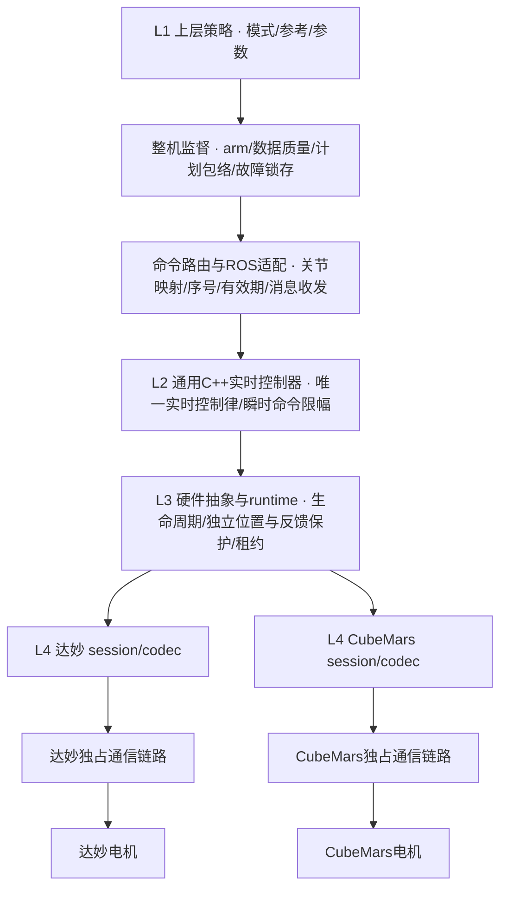

# EXO-ARCH-001：上层计划与实时控制边界

## 已确认的分工

上层选模式、给目标和参数；C++控制器唯一负责实时控制律；底层执行独立保护。
该规则适用于整机主入口 `exoskeleton_control_node`。已有台架脚本是兼容入口，不能与整机上层同时发布。
本轮先完成已验证固定位置阻抗的结构化接口，不把其他Python算法参考实现称为已迁移。



传感器与状态估计是反馈支路，层级与反馈数据流分别见[代码结构](code_structure.md)。

| 层 | 做什么 | 不进入该层的内容 |
|---|---|---|
| 上层Python | 模式选择、arm时捕获固定参考、下发K/D/命令上限、状态监督、撤许可 | 实时PD、速度滤波、实时力矩生成、厂商报文 |
| C++控制器 | 从通用position/velocity计算PD，每次update饱和、方向包络、检查目标与周期 | CAN ID、串口协议、硬件使能权限 |
| hardware/runtime | 最终命令上限、绝对位置/方向、反馈有效性/力矩异常、独立命令租约、整组故障处置 | 步态决策、训练策略 |
| 厂商适配 | 物理单位/协议转换、通信、设备反馈 | 上层算法 |

上层状态监督可以提前拒绝不合格输入，但底层不得依赖它替代保护。
C++命令饱和也不能替代底层最终检查；反馈超限停机是异常检测，与命令限幅职责不同。

## 固定位置阻抗指令 schema 1

插件仍为 `mech_controllers/FixedPositionImpedanceController`，配置时显式选择：

- `command_source=training_command`：规范入口，订阅私有 `~/training_command`。
- `command_source=enable`：兼容独立台架，订阅 `~/enable`，参考仍在控制器激活时捕获。

两种入口互斥，不能用旧Float64许可绕过结构化参数检查。整机上层只允许规范入口；
其他策略的 `output_mode=motor` 在构造时拒绝，其Python控制律只用于离线参考/预览。
旧速度抗阻C++控制器和独立台架入口保留，尚未接入同等目标/参数合同。
模式在配置/激活前选择，不在运行中抢占或切换命令接口。

消息为 `std_msgs/msg/Float64MultiArray`，layout必须为空且offset=0，data长度必须恰好8：

| 索引 | 字段 | 单位/约束 |
|---|---|---|
| 0 | schema | 必须为1 |
| 1 | sequence | 严格递增正整数，最大2^53−1；上层使用本机单调微秒计数 |
| 2 | issued_at | 同一主机monotonic秒，不接受跨主机时钟；不得早于本次激活、未来或接收前100ms以上 |
| 3 | enabled | 精确0或1；0撤销本轴力矩许可 |
| 4 | q_ref | 输出轴rad，arm时捕获；必须处在控制器绝对范围内并留保护余量 |
| 5 | K | N·m/rad，大于0且不超过控制器配置上限 |
| 6 | D | N·m·s/rad，非负且不超过控制器配置上限 |
| 7 | torque_cap | N·m，大于0且不超过控制器配置上限 |

所有字段必须有限。序号和参数一起经过非实时检查并进入同一个RealtimeBuffer，
实时线程从同一帧取参考/增益/上限，不拼接不同消息。
此为当前项目版本化合同，后续若改消息类型或字段必须升级合同与双方测试。
多轴各有一帧，不宣称跨轴原子事务。

## 生命周期、参数权限与失效

上层默认50Hz下发计划；C++按manager周期执行，当前台架标称500Hz，
不会把上层50Hz当作PD采样率。生产实时路径不申请参数服务、不调用Python或设备I/O。

`ImpedanceTrainingPolicy.start`要求反馈速度不超过0.05rad/s，捕获当时输出轴位置。
参考/K/D/cap构成不可变`ImpedancePlan`，随`PolicyTarget`进入监督器和`CommandEnvelope`；
监督器拒绝超包络或激活内变化。`CommandRouter.route_training`在返回任何轴前检查整份计划、
信封时效/序号、各轴上限及身份映射；ROS节点只序列化已验证结果。
禁止将该计划交给标量`route`出口，正常发送保留信封产生时间，不在发布时续期。
C++首次许可还要求参考与当时位置相差不超过0.01rad，避免陈旧锚点启动跳变。
第一次有效执行后，q_ref/K/D/cap在本次控制器激活内固定；改变它们会拒绝执行并锁存故障。
修改计划需停用/重新激活控制器，再重新取得新鲜反馈和arm；仅disarm/arm不重置C++会话。
本轮没有连续轨迹参考、在线增益切换、步态或穿戴控制。

控制器配置 `stiffness_nm_per_rad`、`damping`、`torque_limit_nm` 在规范入口是增益/命令上限的天花板，
上层只能降低，不能越权增加。默认天花板为15、0.5、7N·m；实际底层上限和有效绝对范围仍独立配置。
上层发送cap取 `min(max_command, max_actuator_command)`，不把许可占位0当成PD输出。

源计划年龄达到100ms后不再产生PD力矩；接收时刻的100/106ms分阶段watchdog也继续生效。
重复序号、非法帧、旧激活帧不刷新租约。故障后新计划不能自动恢复；
输出generation只在有效许可租约内更新，硬件侧既有4/6ms保护保持独立。
周期超过6ms、位置/速度无效、越界或运行预算耗尽仍锁存故障，不扩大原有范围。

上层停止时仅发送一帧enabled=0，随后停止续期；这不等于机械制动或已确认失能。
硬件激活、停用及最终独立查询继续由部署流程负责，整机节点不自动操作CAN或使能电机。

## 无设备配置

`motor_training_preview.launch.py` 只启动上层，默认preview/no motor output。
其DM4310 YAML中的±12.5rad为离线fixture，不能作为机构限位部署。
后端离线检查可显式选择：

```bash
ros2 launch mech_bringup dm4310_dual_bringup.launch.py \
  fixed_position_impedance:=true impedance_command_source:=training_command \
  check_only:=true range_file:=/path/to/current_validated_range.json
```

该命令只检查配置，不启动设备。真实部署仍需有效范围证据及当次现场授权；
不得将兼容台架的 `~/enable` 命令与规范 `~/training_command` 混用。
当前上层不会自动核对远端manager插件类型或切换生命周期，仍需部署核对。
本轮软件验证不扩展以前单轴实机结论，不代表双轴或穿戴验收。
