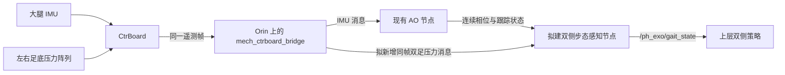

# PH-EXO 双侧步态感知节点设计 v0.1

日期为 2026-11-20，时区 Asia/Shanghai。状态为设计草案，任务标识暂用 PH-EXO-GAIT-PERCEPTION-001。
用户确认双侧外骨骼共用一个整机步态分类。本聊天负责节点、接口和验收设计，原聊天负责 AO 算法、调参和精度评估。本轮交付为设计，实施及验证结果另行记录。

## 当前代码核对

Windows 统一仓库分支 ph-exo/development，HEAD aeb4208d5eecdc79bcf207ab9550ec11cd9ec216。工作树包含大量未提交开发成果，下面描述基于本次读取的工作树文件。

| 入口 | 当前行为与设计影响 |
| --- | --- |
| ros2_ws/src/mech_exo_state/msg/GaitPhase.msg | 已有 source_stamp、state/reason、valid、phase_reference_verified、phase_rad、frequency_hz、accepted_samples 和时效字段。表达 AO 观测。 |
| ros2_ws/src/mech_exo_state/scripts/ao_node.py | 节点 ph_exo_ao，默认 /imu/imu1/data 的 X 轴，输出 /ph_exo/gait_phase。接收回调和 10 ms 定时器均发布；header 是发布时间，source_stamp 保留最后接受输入时间。phase_reference_verified 固定 false。 |
| ros2_ws/src/mech_exo_state/scripts/ao_core.py | 状态 INVALID、ACQUIRING、TRACKING、STOPPED；valid 表示 TRACKING。STOPPED 依据输入运动窗口，当前默认 window_s=0.6、stable_hold_s=0.6。 |
| ros2_ws/src/mech_ctrboard_bridge/src/bridge_node.cpp | 左右 raw 为 UInt16MultiArray、total 为 UInt32，sensor_status 为 UInt8MultiArray，设备毫秒计数为独立 UInt32。压力消息自身缺少 Header 和共同序号。IMU Header 使用桥接处理时 now()。 |
| ros2_ws/src/mech_exo_state/msg/RobotState.msg | 当前电机与机构模型字段针对 104/105 和一套 ψ/β，包含两路 IMU。hardware_freshness_verified 固定 false。双 IMU 数量不能证明已完成左右大腿安装映射。 |

Windows AO-Evaluation/reports/ab06_cadence_start_20261120.md 记录了右大腿正向 Z、整周期残差归一化、0.60 s 稳定/恢复等待和估频启动对照。其固定相位偏移属于该数据评估配置，正式 ROS 默认仍为 X 轴。节点实施前由 AO 聊天交付明确的算法版本、轴侧映射和配置，避免混用候选与正式核心。

## 组件与职责

新增一个轻量 ph_exo_gait_perception 节点，优先放在已有 mech_exo_state 包中，使用纯逻辑核心与 ROS 包装的现有组织方式。新增接口放在已有 ph_exo_interfaces 包，实施前检查依赖图以保持无循环依赖。

大腿 IMU 与左右足底压力阵列均通过 CtrBoard 接入 Orin。mech_ctrboard_bridge 解码同一条 SensorTelemetryWire 遥测帧，取出两路 IMU 和双足压力。ROS 从桥接节点分出两条处理支路，左右侧策略共用一条整机步态消息。

桥接在每个有效遥测帧解码后读取一次 ROS 时钟，用同一 message_stamp 发布该帧的两路 IMU。拟议的 BilateralFootSample.header.stamp 直接复用这个值，并在同一消息中携带该帧的 device_time_ms。这样可按源帧对照足底读数和 AO 所依据的 IMU 样本。AO 估计可晚于足底消息到达，双方各自使用源样本时间判断新鲜度。共同帧时间用于软件对齐，传感器物理采样时差仍待测量。

第一版由现有 AO 提供一个连续周期估计，显式配置其来自哪侧大腿。整机分类只维护一套状态机。后续双侧 AO 融合属于 AO 模块交付内容，节点接口继续接受一个统一相位结果。

## AO 输入合同

继续订阅现有 /ph_exo/gait_phase，类型 mech_exo_state/GaitPhase。当前输入按以下规则解释。

- source_stamp 为估计所依据的最后接受 IMU 时间；header.stamp 为 AO 发布时刻。输出 phase_rad 对应 source_stamp，不把它标记成发布时刻的预测相位。
- 用 source_stamp 与 accepted_samples 识别新估计。定时重发可以携带失效信息，应即时处理；只有源样本推进才刷新数据新鲜度和运动历史。
- valid、state 和有限数值共同决定 tracking_valid。INVALID、ACQUIRING、STOPPED、时间过期或异常值均令 tracking_valid=false。
- frequency_hz 明确为同侧完整跨步频率。步数每分钟如以后需要，另注明转换口径。
- phase_rad 保留振荡器坐标。右触地零点通过带标定标识的固定映射转换，phase_pct=100×wrap(phase_rad/(2π)+offset_cycles)。需记录参考侧、输入侧、轴向、符号和算法配置版本。
- phase_reference_verified 的当前 false 直接阻止宣称真实触地相位已验证。数据集校准可在限定回放配置中作为已知映射；移植到穿戴硬件仍需独立校准。
- 当前消息缺少 producer session ID。第一版仅允许单一 AO 发布者；源时间回退、计数回退、超时后重连均清空接收上下文并重建。实施时建议 AO 包装增加会话标识的可兼容版本化接口，解决重启后时间与计数恰好重合的歧义。

AO 原聊天交付最小内容为核心/配置版本、输出字段定义、输入侧与轴向、时间域、零点映射来源、重置及失锁恢复语义、固定样例输入输出。节点侧不改算法门限。

## 双足输入合同草案

建议新增 BilateralFootSample，一条消息承载同一设备帧的双足数据。由 CtrBoard 桥接处理完整帧时生成，旧数组话题保留兼容。

| 字段 | 类型与含义 |
| --- | --- |
| header.stamp | ROS 时间域的桥接完整帧处理时刻，当前只能表示主机处理时间 |
| session_id / sequence | string / uint64，桥接会话标识及单调递增帧序号 |
| device_time_ms | uint32，原始设备计数；回绕与重启由适配层判别 |
| time_basis | 枚举 HOST_RECEIVE 或 DEVICE_SYNCED；后者必须有已验证设备时钟映射 |
| left_raw / right_raw | uint16[]，通道顺序随配置固定并校验长度 |
| left_total / right_total | uint32，原始总量；标定前不赋予 N 或 kPa 单位 |
| left_valid / right_valid | bool，基于帧、通道和传感器健康判断 |
| calibration_id | string，压力阈值及左右映射配置版本 |

主机收到全零不能单独证明脚已离地，须有有效传感器状态及映射。现有 fsr_phase/status 的固件含义尚待核对，作为诊断原值保留。独立发布的设备时间不能按相邻到达顺序拼回某一条压力数组。

接触提取对每足使用经标定的总量/有效通道指标、接触与离地双阈值及持续确认时间。第一版确认窗口以事件源时间计时；记录候选边沿时刻 event_stamp 与确认发布时刻 confirmed_stamp。状态只在确认后改变，历史输出不回填。掉帧、时间异常、通道失效清除候选边沿。阈值与确认时长由同步压力数据定标，当前作为显式参数。

若已有可靠 FootContactEvent，适配器可直接输入纯核心，最少包括会话、序号、左右侧、IC/TO、事件与确认时间、当前双足接触状态、有效性和来源。生产首版优先直接消费同帧双足样本，避免另增一个常驻事件进程。

## 唯一整机四相

| gait_phase | 进入事件 | 当前接触 L/R | 合法下一事件 |
| --- | --- | --- | --- |
| RDS | 右 IC | 1/1 | 左 TO |
| LSW | 左 TO | 0/1 | 左 IC |
| LDS | 左 IC | 1/1 | 右 TO |
| RSW | 右 TO | 1/0 | 右 IC |

周期右 IC → 下一右 IC，右 IC 计数一次。IC 为首次接触，TO 为整足离地。

UNKNOWN 表示四相无法可靠确定。初始化双足接触时进入 UNKNOWN；观测到可信 0/1 或 1/0 可获得 LSW/RSW 支撑候选，运动状态另行判定。双支撑需事件历史才能区分左右。相位跳跃、同时矛盾事件、双足离地及时间异常使四相无效；保存原因，重新从可信单支撑或有效交替事件序列建立状态。重复事件去重，缺失事件不凭 AO 百分比补造。

motion_state 单独表达 UNKNOWN、STATIONARY、CYCLIC_MOTION。仅在双足接触有效且 IMU 低运动持续满足参数条件时确认 STATIONARY，此时 gait_phase=UNKNOWN。AO 的 STOPPED 单独作为观测状态，不能仅据此确认双脚站立。单脚静态支撑允许接触模式有效，但不据此宣称在走路。

四相依赖的脚接触状态与连续周期估计分别有有效性。AO 失锁时，如足底数据新鲜且事件序列可靠，可继续输出四相。压力掉线时，四相置 UNKNOWN；已标定且有效的 AO 连续相位可继续输出，并明确足底不可用。无方向/地形分类器时 locomotion_mode=UNKNOWN；直行回放可注明输入试次标签，在线不能仅从四相推出直行或坡度。

## 既定四相内的进度估计与预测

目标是在当前整机 gait_phase 内估计从本相入口到出口的进度，并短时预测该进度。原 phase_pct 表示右脚两次触地之间的整周期进度。新增 subphase_progress_pct 专指当前一相，例如 LSW 期间从左脚离地的 0% 走向左脚触地的 100%。四个阶段各有自己的长度。

一个 AO 跨相连续运行。足底事件（Windows 回放可用已到达的事件标签）确认切换时，感知节点保存边界源时刻和该时刻展开后的 AO 角度作为新相入口。确认存在去抖延迟时，从已到达的带时间戳 AO 短缓存求边界角度，再计算最新 AO 帧的进度。首个公开值可能大于零。缺可靠入口、事件与 AO 无法按时对齐、AO 失锁或短段内漏掉边界时撤销相内进度有效性。

首版估计用 AO 自入口以来的展开相位增量除以该类阶段的预期 AO 相位跨度，再乘 100。四类各自标定跨度，可用独立标定试次冻结初值，在线更新只使用当时已观测完整且质量合格的同类段。跨度不足、非正、异常跳相或无初值时报告不可用。因为使用相对角度，整周期零点的常数偏移会相消。相内有效仍要求已验证当前配置的阶段跨度和边界对齐。原聊天负责 AO 相位和频率，感知节点负责事件锚定、相内换算和预测。

以当前 AO 源时刻加短时长 h 为预测目标，在稳定频率近似下按 2π × frequency_hz × h 推进角度。输出预测的相内进度或距下一合法事件的估计剩余时间。若预测触及边界，标记预测范围已到边界并终止本相百分比外推。只有实测事件确认后切换整机相位。预计结束已到而事件仍缺失时，标记超出模型范围、撤销该预测有效性并记录超期。停步和任一所需输入过期时清除相内估计与预测。

## 整机输出 GaitState 草案

话题 /ph_exo/gait_state，建议类型 ph_exo_interfaces/GaitState。字段以下列分组为准，枚举在实施时写入 .msg 常量。

| 字段 | 语义 |
| --- | --- |
| header.stamp、session_id、sequence | 感知节点发布时刻、会话与输出序号 |
| ao_source_stamp、feet_source_stamp | 两条支路最新接受的源时间；分别校验时效 |
| tracking_state、tracking_valid、ao_phase_rad | 保留 AO 状态和振荡器相位，便于观测与诊断 |
| phase_reference_verified、phase_valid、phase_pct | 右触地零点映射资格、连续相位可用性及 [0,100) 百分比；无效 phase_pct=NaN |
| stride_frequency_hz | 有效跟踪时输出跨步频率，失效为 NaN |
| subphase_progress_pct、subphase_progress_valid | 当前已确认相内的实时进度估计，对应 ao_source_stamp。无效为 NaN。 |
| predicted_subphase_progress_pct、prediction_stamp、prediction_valid | 预测目标源时刻及该时刻在本相内的进度。跨越本相可预测范围时为 NaN。 |
| time_to_next_event_ms | 距预期下一次切换的估计剩余时间，参考 ao_source_stamp。无可靠预测时为 NaN。 |
| gait_phase、gait_phase_valid、phase_since | 整机四相、独立有效性及当前相位事件源时间 |
| left_contact、right_contact | 各为 UNKNOWN/AIR/CONTACT 三值，防止未知冒充离地 |
| motion_state、locomotion_mode | 运动状态与行走模式，第一版模式默认 UNKNOWN |
| ao_age_ms、feet_age_ms、input_skew_ms、time_aligned | 支路时效和跨源时间质量；不相容时间域时 skew 为 NaN、aligned=false |
| calibration_id、quality_flags | 映射/阈值版本，以及无压力、未标定、失锁、过期、顺序异常等可并存位标志 |

phase_valid = tracking_valid AND phase_reference_verified AND AO 时间有效 AND 数值有效 AND motion_state!=STATIONARY。它不依赖当前压力必须在线，除非当前校准配置显式规定在线触地修正为必要条件。在线触地重置/相位纠偏算法留给 AO 模块明确交付后再接入。

phase_pct 和 subphase_progress_pct 对应观测源时刻。预测字段单列目标时刻和有效性；控制器可明确区分已确认的当前相、相内进度估计和提前预测。

## 时间、调度与失效

ROS 包装负责时间域转换，纯核心使用注入的逻辑时钟，回放也以同一逻辑时钟推进。源时效和接收时效分别检查；ROS 时间跳变后清空状态，要求重新建立。现场硬件源时钟未校准时标注 HOST_RECEIVE。

建议事件驱动处理，每个新输入更新一次快照，10 ms 定时器检查过期并发布状态。输入新鲜度只依赖真正的新源样本。AO 输入沿用 BEST_EFFORT/depth=1；足底样本初拟 RELIABLE/小有界队列，要求可靠发布者且按帧序检测积压/缺帧；输出初拟 RELIABLE/depth=1、VOLATILE。最终 QoS 在 Orin 发现与故障测试中确认。

超时、最大跨源偏差、确认时长作为版本化配置。首版回放夹具可用 timeout=100 ms、watchdog=10 ms、max_skew=20 ms 做边界测试，这些是软件测试配置，现场门槛由实测确定。AO 的 0.60 s 恢复等待属于原算法配置；节点收到 AO invalid 后立即撤销连续相位有效性，不追加一轮恢复等待。压力与 IMU 融合判断只使用时间可比且满足偏差限制的数据。

感知节点采用独立进程和有界缓存，常规回调只做有限计算，数据记录由外部记录器承担。控制器的 5 ms 周期与感知发布周期分别验收。感知有效标志由上层策略使用，电机使能、力矩和停止策略继续由已有监督及控制层负责。

## Windows 回放验收方案

本轮仅设计，下表全部为待执行。实现采用无 rclpy 依赖的纯核心，Windows 先验证同一核心，再由 Orin 软件图核验 ROS 接口和调度。

| 检查 | 输入与判据 |
| --- | --- |
| 四相基准 | 手工标注且含左右起步的事件序列，逐帧状态及四条边界完全匹配；整机只有一个分类输出 |
| 初始化与站立 | 初始双接触为 UNKNOWN；静止、单脚保持、起步与停步分别验证，禁止用双接触快照猜 RDS/LDS |
| 缺压力/单侧故障 | 左右分别断流、全零失效、通道缺失；对应接触变 UNKNOWN，四相失效，AO 支路独立验收 |
| AO 失锁/恢复 | 注入 TRACKING→ACQUIRING/STOPPED/INVALID；下次处理即令 phase_valid=false，足底四相可独立有效；恢复等待完全继承 AO |
| 重复与重发 | 相同 source_stamp/count 的有效重发不续期；相同源样本附带 invalid 必须传播；状态变更不伪装成新样本 |
| 时间与丢帧 | 延迟、乱序、重复、未来时间、设备计数回绕、ROS 时钟跳变、进程重启、源静默；不产生伪新鲜数据或伪事件 |
| 压力抖动 | 阈值边界与短毛刺不重复触发；记录 event_stamp→confirmed_stamp 延迟，输出无事后回填 |
| 矛盾序列 | 错误侧事件、跳相、缺少事件、两足同时腾空令 UNKNOWN；新可信序列可重新捕获 |
| 标定 | 未标定时 AO 可 tracking_valid=true，phase_valid=false；已知固定偏移的合成样例精确映射右 IC=0%，跨 100% 环形连续 |
| 因果性 | 同一输入前缀在完整和截断回放中输出完全相同；禁止读取未来触地给在线输出回填标签 |
| 超时边界 | 逻辑时钟确认超时后最迟一个 watchdog 周期内失效，重发不能推迟；真实调度耗时另外报告 |

已有 AB06 跑台 0.65/1.05 m/s、其他速度、地面常速与慢速直行作为待用户选择的回放组。读取前核对每组实际具有哪些事件标签；只有右侧 IC 时可评分连续相位，四相边界评分需两侧 IC/TO。将真实标注转换成事件输入能验收融合逻辑；真实压力至接触阈值的识别性能需压力数据独立验证。

每组输出连续相位环形 MAE/P95/最大误差、有效覆盖率、首次有效等待、失锁恢复等待、停步后残留有效时间；同时报告共同有效帧和新增有效帧误差。四相输出按类 precision/recall/F1、宏 F1、混淆矩阵、UNKNOWN 比例、全时间覆盖率、四种事件确认延迟和时间加权边界误差，UNKNOWN 计入覆盖损失。

相内进度按四类分开评分。明确第一版百分比的验收口径为相内经过时间占该次真实相长的比例。离线参考为 100 × (t − 本次入口时刻) / (本次出口时刻 − 本次入口时刻)。预测按其目标时刻评分，同时记录提前或延迟到达下一边界的毫秒误差、越界预测率和有效覆盖率。与“已过时间 / 历史同类相平均时长”在同一试次同一帧对照，分别报告低速、变速、停步和两个短双支撑段。先按整试次划分标定与评估，在线输入在事件确认时才可见；未来出口只交给评分器。

当前无同步压力数据，四相真实识别精度和停步时间验收阈值待数据基线确定。第一版软件验收要求确定性夹具全部通过、故障处理符合表中语义、与冻结 AO 输出逐样本一致。Windows 记录核心耗时 P50/P95/P99/max 与输入到输出排队时长；其数值作为本机性能记录。Orin 后续独立验证构建、消息、QoS、重启、断流、计数、时钟与并行 5 ms 控制软件负载。

## 实施顺序与职责

1. 本聊天评审并冻结上述输入/输出及有效性语义，落地纯核心和确定性夹具。
2. AO 聊天交付冻结版本与样例，本聊天完成适配一致性检查；双方按文件职责协作，避免并发修改 ao_core.py/ao_node.py。
3. Windows 完成事件回放与故障矩阵，再同步到 Orin 执行无设备 ROS 软件验证。
4. 同步双足压力数据到位后完成阈值标定与四相识别评分，再评估上层策略接入。

本次已执行源码与文档只读核对、Git HEAD/status 检查及草案完整性检查。节点实现、Windows 回放测试与 Orin 测试均待后续实施。