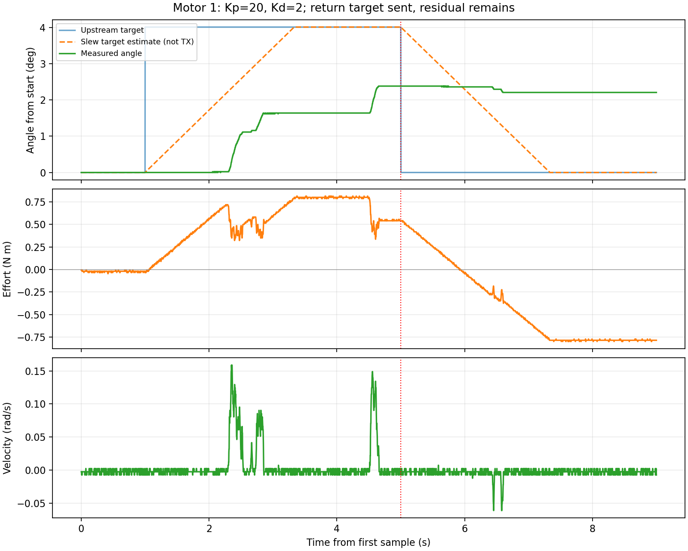

# DM4340 返回阶段分析与2 N·m预算内调参

任务：EXO-ARCH-001。依据[位置阻抗台架记录](2026-10-21-dm4340-position-impedance.md)
中的Kp=20、Kd=2、+0.07 rad试验；本轮只分析历史记录、生成临时参数并验证无设备回环。
没有访问真实串口、发送电机命令、修改寄存器或变更仓库默认部署配置。

## 记录揭示了什么

蓝线是上游原始目标，绿色为反馈角度；橙色虚线是依据控制器限斜率和记录器主机时间
计算的目标估计，**不是捕获的控制器输出／CAN TX**。红线标记返回阶段开始。
CSV是ROS回调记录，包含重复的同一反馈，不能当作独立CAN帧或精确执行时间。

| 返回阶段观察量 | 数值 | 解释 |
|---|---:|---|
| 上游目标 | 返回原始起点−2.209697 rad | 不是忘记发返回目标 |
| 返回记录持续时间 | 3.99722 s | 与设置的4秒吻合 |
| 返回阶段首次负反馈力矩 | 约0.917 s后 | 力矩确实转为回位方向 |
| 0.07 rad目标按0.03 rad/s斜率归位 | 名义需2.333 s | 返回前段仍可能有正向弹簧力，不能仅凭早期正力矩判断方向错误 |
| 返回阶段实际位移 | −0.00305180 rad（约−0.175°） | 有少量回位，非完全不动 |
| 最后一次可见角度变化 | 返回开始后约1.593 s | 此后记录角度不再变化 |
| 最后1秒反馈位置跨度 | 0 rad | 已形成残差平台 |
| 最后1秒反馈力矩中位数 | −0.786325 N·m | 有持续回位力矩，并非命令被停发的证据 |
| 最后1秒反馈速度中位数 | −0.002442 rad/s | 近零量化读数，不能解释为持续可见回转 |
| 最终位置残差 | +0.03852892 rad（2.20754°） | 未回到起点 |
| 按最终角度／速度计算名义PD项 | −0.755926 N·m | 与约−0.79 N·m反馈同量级，不是精确力矩计量一致性认证 |

本轮manager无ERROR/FATAL，下层没有拒绝反馈或命令。
2号被阻止是在1号流程结束后，运行器发现残差超过原位核对的0.005 rad；
该闸门并没有在返回过程中截断1号。

记录**支持**“纯位置弹簧在阻滞下留下静态误差”的解释：位置误差变小后，回位力矩也随之减小；
当前控制律没有积分或摩擦补偿。静摩擦、齿槽、外部机械卡滞、驱动限流及实际轴映射
尚不能从这份记录中分离，不能宣称已确认某一个物理根因。
没有实际TX记录，也不能把限斜率目标估计当作已经独立验证的最终目标帧。

## 已生成的下一组参数

| 参数 | 已测旧值 | 新的离线候选 | 原因 |
|---|---:|---:|---|
| Kp（N·m/rad，电机坐标） | 20 | 40 | 相同位置残差可产生更大回位弹簧项 |
| Kd（N·m·s/rad） | 2 | 2 | 保留阻尼，低速停滞时降低Kd收益有限 |
| 目标偏移 | +0.07 rad（4.01°） | +0.035 rad（2.01°） | 保留静止目标弹簧项约1.4 N·m |
| 位置目标斜率 | 0.03 rad/s | 0.015 rad/s | 降低高刚度下指令推进速度；偏移／斜率之比仍2.333秒 |
| 最大目标偏差 | 0.08 rad | 0.04 rad | 与增益成套收紧，不能只提高Kp |
| 反馈速度保护 | 0.2 rad/s | 0.2 rad/s | 保留 |
| 反馈力矩保护 | 2 N·m | 2 N·m | 保留用户要求的名义预算上限 |
| 实际相对位置边界 | ±0.2 rad | ±0.2 rad | 保留，真实使用前按新鲜读回建立绝对范围 |
| 时间 | 原位1秒／偏移4秒／返回4秒 | 相同 | 先保持短时逐轴试验，不延长积累过程 |
| 初始原位核对 | ±0.005 rad，速度<0.05 rad/s | 相同 | 不为进入2号而重设原点或跳过残差 |
| 速度参考／力矩前馈 | 0／0 | 0／0 | 保持原生固定增益位置模式 |
| 命令租约／反馈时效 | 4/6 ms／40 ms | 相同 | 不以放宽时效掩盖问题 |

scale=1时，新预算为 `40×0.04+2×0.2=2 N·m`。
若只把Kp提高到40而保留0.08 rad误差，预算会变为3.6 N·m，因此该组合不可采用。
以上仍是反馈有效且模型成立时的名义预算，不是设备内部硬限流或停止距离保证。

若假设相同阻滞力矩约0.8 N·m，静态关系`误差≈阻滞力矩/Kp`从0.04 rad降到0.02 rad；
这只是敏感性估算，仍可能约1.15°，**不是精确回零保证或摩擦参数测量**。
新参数也没有经辨识的惯量／阻尼模型，不能宣称已经验证真实闭环稳定性。
如需精确位置控制，应在机械／映射核实后另行设计有界补偿或积分及抗饱和，
不能靠持续增加刚度替代该工作。

## 实际完成的验证及限制

- 新临时配置和脚本语法、两轴参数及2 N·m名义预算断言通过。
- 使用已安装的通用PositionCommandController及无设备CompositeSystem：两轴各9秒，
  0→0.035→0 rad，9002个ROS回调、正常退出，manager无ERROR/FATAL。
- 回环没有机械惯量／静摩擦模型，也没有执行真实电机端Kp/Kd；因此只验证ROS时序、
  限斜率目标及清理流程，不验证真实回位效果或增益稳定性。
- 临时候选所有验证／使能声明置false，离线入口只允许shadow，未把历史参考位置当作新实机原点。
- 回环manager已停止。未运行真实电机复测或生产代码完整回归，因为本轮生产代码未改。

本机原始证据：`/home/nvidia/mech_attitude_validation/position_impedance_2nm/real_trace.csv`。
分析脚本、summary.json和原图在同级`position_return_analysis/`；候选配置／脚本／回环日志
在同级`position_impedance_retuned/`。这些个人绝对路径仅为本机证据，不是团队部署入口。

下一步是单独授权这组小角度候选的受限实机复测，记录真实控制器输出／TX目标、
位置和反馈力矩；仍保留返回残差闸门，未到位不自动进入2号。
