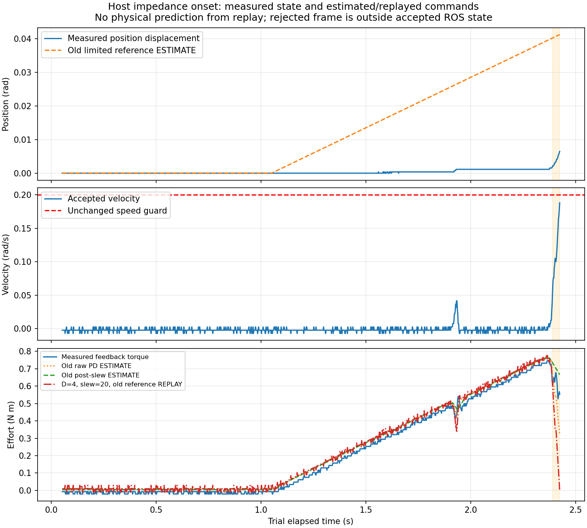
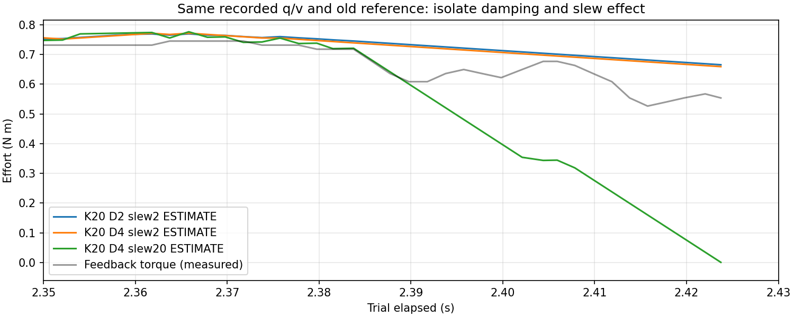

# 主机阻抗起动速度上冲分析与调参候选

> 历史记录：2026-10-22已按用户要求移除主机阻抗代码、插件、配置和启动选项。本文保留历史证据，当前使用[原生MIT位置阻抗](../development/dm4340_position_impedance.md)。

任务：EXO-ARCH-001；日期：2026-10-22。
输入为[已授权实机首测](2026-10-22-host-impedance-bench.md)的1192条ROS记录与底层首个拒绝帧。
本轮只读取历史记录、检查当前控制代码、做固定观测轨迹回放；没有真实设备I/O。
分析脚本、JSON汇总和候选参数在仓库外`host_impedance_onset_analysis/`验证目录。
生产代码、默认配置及设备寄存器未修改。

## 结论分级

**已确认的数据事实**：目标开始前进后，轴角先小动，随后在编码器分辨率内停住；
反馈力矩继续上升。末段约34ms内速度迅速上升，同时位置有相符的正向变化，
随后底层接收到0.202686rad/s而触发0.2rad/s保护。不是只有一个无位置变化的孤立速度尖峰。

**已确认的实现约束**：主机控制器先计算弹簧／阻尼力矩，再对总力矩做双向斜率限制。
原2N·m/s既限制增力，也限制阻尼请求的减力；位置目标斜率0.03rad/s不是实际速度控制环。

**有依据但未唯一验证的解释**：跟随滞后造成弹簧力矩累积，机构从停滞转为运动时出现快速释放，
总力矩限斜率又使阻尼的减力响应变慢。物理表现与间歇起动相符，
但不能据此唯一认定静摩擦、齿隙、负载、电流环或编码量程中的哪一项是根因。

**尚不能证明的内容**：没有记录控制器内部限斜率参考、原始PD、最终effort命令或真实TX，
因此无法给出准确的主机减力延迟／饱和幅度，或预测新参数后的实机速度峰值。
电机反馈力矩也不是主机命令，更不是标定力矩传感器结果。

## 记录中的起动过程

时间均为台架脚本开始后的秒数，不能直接当作硬件帧时间戳。

| 事件 | 时间／区间 | 观察 |
|---|---:|---|
| 上游切入偏移目标 | 1.051832s | 原位→+0.07rad；位置参考继续受0.03rad/s斜率约束 |
| 首次速度>0.02rad/s | 1.921813s | 位置已变约0.000763rad，随后又停住 |
| 轴角平台期 | 2.002171～2.367832s | 轴角采样范围为0，反馈力矩约0.5265→0.7453N·m |
| 快速起动 | 2.389777～2.423734s | 速度0.056166→0.188034rad/s，约33.96ms |
| 同段轴角变化 | 上述33.96ms | +0.004578rad，均速约0.1348rad/s，与明显运动相符 |
| 被拒绝的下一段反馈 | 独立底层诊断 | 0.202686203rad/s>0.2，力矩0.567521N·m<2 |

快速段速度差对应平均加速度约3.883rad/s²。
保护帧未作为有效ROS状态发布，不能用ROS曲线最大0.188034rad/s否认保护发生。
最后状态变化后的重复尾段不参与卸力回放，避免把故障后的旧状态当成仍在控制。



图中实线为记录数据；参考、原始PD和限斜率输出都明确标为ESTIMATE／REPLAY，
不是实测内部状态。最后被拒绝帧只存在底层诊断中，不拼接成有效ROS控制样本。

## 为什么慢参考仍会超速

原控制律为：

```text
τraw = K × (qref − q) − D × v
τbounded = clamp(τraw, −τmax, +τmax)
τout = τprevious + clamp(τbounded − τprevious, −S×dt, +S×dt)
```

轴角暂时不动时，原参考仍以0.03rad/s前进，K=20使弹簧项名义上每秒增长
`20×0.03=0.6N·m`。系统没有积分器，不能把这种位置误差累积称为积分饱和。

起动快速段，单是D=2的阻尼项需要平均约
`2×3.883=7.77N·m/s`的减力变化，尚未计入位置误差缩小带来的减力。
原总力矩变化率只允许2N·m/s，在33.96ms中最多改变约0.0679N·m，
因而不能假定算出阻尼后就能立即把同样的阻尼作用下发。

按ROS回调间隔估计的末段参考偏移约0.04122rad，
弹簧项约+0.6947N·m，阻尼项约−0.3761N·m，原始PD约+0.3186N·m。
这是估计值；实际反馈力矩约+0.5538N·m不能直接拿来当`τout`。
例如基准回放估计`τout≈0.6655N·m`，本身与反馈有差异，说明不能把回放误当成测量证据。

## 固定观测轨迹回放比较

为隔离阻尼与力矩斜率影响，以下三组沿用同一条记录q/v和同一个旧参考估计：

| 回放参数 | 快速段平均估计输出N·m | 最后估计输出N·m |
|---|---:|---:|
| K20／D2／力矩斜率2 | +0.6993 | +0.6655 |
| 仅D提高到4，斜率仍2 | +0.6931 | +0.6593 |
| D4／斜率20，上限1.2 | +0.3043 | +0.0006 |

第三组回放最大输出约0.7765N·m，未触及1.2上限；在这条轨迹上的改善主要来自减力响应，
不是简单降低饱和上限。只加D时，较强的阻尼请求仍被旧力矩斜率压住，
所以输出改善很小。以上都不是新参数下的闭环运动预测：真正换参数后q/v也会改变。



## 下一轮候选参数

按用户最新要求，初版离线候选的K由20提高到30、力矩上限由1.2提高到2.5N·m。
上面的K20固定观测比较保持为历史分析，不代表这一新版候选的闭环效果。
以下是审查候选，不覆盖仓库默认配置，不授权运动；不沿用旧测试原点。
全部值都能用现有控制器参数表达，没有声称已实现独立增力／卸力限速。

| 参数 | 原实测配置 | 候选 | 目的 |
|---|---:|---:|---|
| stiffness | 20 | 30N·m/rad | 同样位置误差下弹簧力矩增加50%，也可能加重起动上冲 |
| damping | 2 | 4N·m·s/rad | 加强运动后的反向阻尼 |
| max_slew_per_second | 0.03 | 0.015rad/s | 参考速度减半，停滞时名义弹簧增力率0.6→0.45N·m/s |
| max_effort | 2 | 2.5N·m | 提高可用命令上限，不要求恒定输出2.5 |
| max_effort_slew_per_second | 2 | 20N·m/s | 减少总力矩斜率对阻尼卸力的拖延；500Hz下每周期最多0.04N·m |
| 目标偏移 | +0.07 | +0.05rad（约2.86°） | 缩小目标；静止在原点时最终弹簧项约1.5N·m |
| max_position_error | 0.08 | 0.06rad | 缩小允许位置偏差 |
| 速度保护（主机／下层） | 0.2 | 保持0.2rad/s | 不通过提高阈值掩盖上冲 |
| 下层命令／反馈力矩限制 | 2／2 | 2.5／2.5N·m | 与主机候选和真实映射共同审核；不只改上层 |
| 实际位移限制 | ±0.2 | 保持±0.2rad | 重新读原点后设置每轴下层包络，不重用历史绝对角 |
| 阶段 | 1+4+4 | 原位1s→偏移6s→返回6s | 新目标斜坡约3.33s，给偏移／返回观察留出时间 |
| 前馈／原生Kp/Kd／租约 | 0／0／原值 | 保持 | 不加摩擦补偿、不加积分、不放宽时效 |

**斜率20同时允许增力更快，不能把它描述为只加快卸力的保护。**
较慢参考使停滞时名义弹簧增力率仍低于原实测值；新版刚度和力矩上限提高，
不能据此保证速度、加速度或噪声响应安全。
D增大也会放大速度量化噪声；当前协议速度量化步长约0.004884rad/s，
D=4时一个速度码对应约0.01954N·m阻尼变化。未添加会拖延阻尼的滤波来遮盖噪声。

在误差0.06、速度0.2的边界，未裁剪PD绝对值上界为2.6N·m；候选显式裁剪到2.5N·m，
不能把原始PD预算与最终指令上限混为一谈。实际力矩仍以反馈保护和设备能力独立约束。
2.5N·m是允许上限；原点静止且参考到达+0.05rad时，弹簧项为1.5N·m，
并不自动输出2.5N·m。能否克服当前机构阻力、是否能到位和返回，均未实际验证。

## 复测验收与待补证据

下一步先核对候选的闭环命令记录方案：在有界、非阻塞记录器中取得时间对齐的
`qref_limited / τraw / τout / q / v`，并明确它们来自控制器更新还是ROS反馈回调；
目前已有记录器缺少前三项。不能用同一条历史q/v回放代替这项证据。

随后才审核受限逐轴测试：先1号，返回和停稳通过后再2号；
原位核对、首个拒绝帧、任一异常停组、最终独立查失能保持不变，不自动重试或重置原点。
若发生超速、力矩越界或残差阻止下一轴，应按失败记录，不提高阈值继续。
本分析没有认定候选已通过实机，也没有把最大参考斜率当作实际速度保证。

后续已按新版完整包络执行一次[K30实机复测](2026-10-22-host-impedance-k30-bench.md)：
1号完成阶段序列但返回残差未过下一轴原位门限，2号未进入目标测试，两台最终独立确认失能。
本篇离线估计仍不作为内部命令实测证据。
