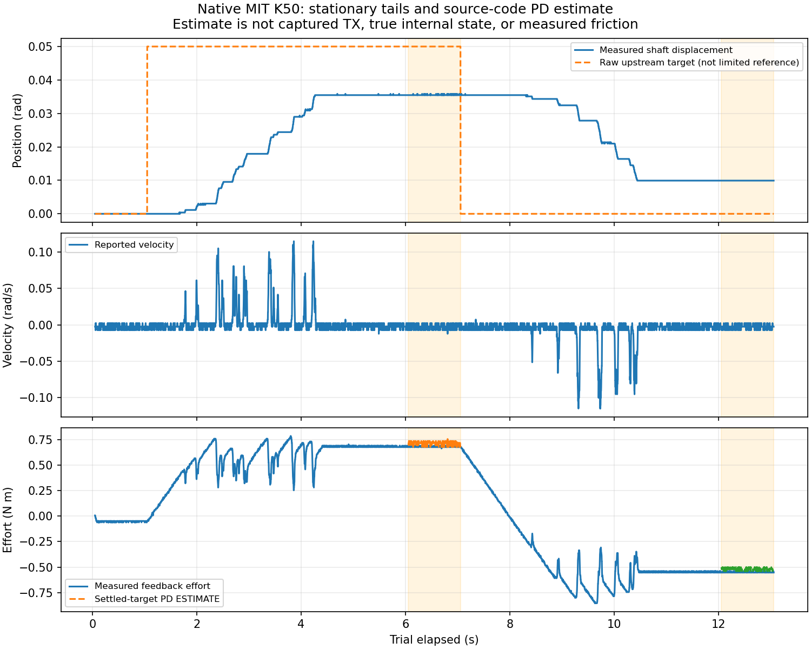

# 原生MIT静止段PD、量化与调参方案

任务：EXO-ARCH-001；日期：2026-10-22。
本轮只分析[原生Kp30](2026-10-22-native-position-restore.md)和[Kp50加力验收](2026-10-22-native-position-k50-acceptance.md)
的历史记录、配置及当前源码；没有串口I/O、运动、寄存器读取或系统设置变更。

## 核对结果

源码`Dm4340MitSession::prepare_position()`编码`{位置目标, 0, Kp, Kd, 0}`，
前置控制器只限制位置目标斜率与时效。当前没有积分、摩擦补偿或主机PD；原生增益保持配置时固定。
不能把反馈保护4N·m理解为设备恒定输出4N·m或硬力矩裁剪。

用当前C++ `encode_mit()`源码构建无设备探针，重新编码各静止段的上游目标。
按部署声明的位置±12.5rad、速度±10rad/s、力矩±28N·m反解字段：

| 编码项 | 实际值／步长 | 意义 |
|---|---:|---|
| 位置一个码 | 0.000381476rad，约0.021857° | 小于0.005rad验收门限；K50返回残差约26个码 |
| 速度一个码 | 0.004884005rad/s | 近零反馈码不代表真实连续转动 |
| 力矩一个码 | 0.013675214N·m | 反馈是设备估计，不是标定负载测量 |
| Kp50编码后 | 49.938950 | 与50相差约0.12%，不足以解释本轮精度差距 |
| Kd4编码后 | 4 | 此值可精确编码 |
| 零速度参考编码后 | −0.002442002rad/s | 对称区间使用奇数最大码，零不在精确码点上 |
| 零力矩前馈编码后 | −0.006837607N·m | 小偏置，不能据此将返回残差归因于大幅漏发力矩 |
| K50返回目标编码偏移 | −0.000381306rad，约−0.021847° | 原点来自六位小数读回，向下量化可能落到相邻码 |

不修改编码舍入或协议量程来追求本轮过关；当前量程来自已有部署声明，本轮未重新读取设备寄存器。
这些是源码探针结果，**不是实机捕获的TX、固件内部变量或已独立验证的设备解码量程**。

## 静止段PD与反馈比较

截取各阶段最后1秒。0.05rad按0.015rad/s名义需3.333s，6秒阶段足够让正常限斜率参考抵达目标，
以下因此以已编码上游目标近似末段参考；记录中仍缺真实控制器输出和TX，不能把近似当成实测。
使用`Kp_encoded × (q_encoded_target − q_feedback) + Kd_encoded × (v_encoded_ref − v_feedback) + ff_encoded`。

| 历史配置／阶段 | 位置跨度rad | PD估算中位数N·m | 反馈中位数N·m | 反馈减估算N·m |
|---|---:|---:|---:|---:|
| K30／偏移末段 | 0 | +0.666450 | +0.649573 | −0.016878 |
| K30／返回末段 | 0 | −0.725772 | −0.745299 | −0.019527 |
| K50／偏移末段 | 0.000381476 | +0.717081 | +0.676923 | −0.040158 |
| K50／返回末段 | 0 | −0.521201 | −0.553846 | −0.032645 |

四组量级和方向相近，没有出现返回力矩反向或名义量级差一个数量级的证据。
K50的角度／速度／力矩各一个码对PD／反馈比较的敏感性总和约0.0523N·m，
可见约0.03～0.04N·m差值不能用来单独认定协议错误；这个码步长之和不是物理模型误差置信区间。
静止段阻尼估算中位数为0，是编码速度参考与反馈中位数同码造成的，不代表真实内部阻尼精确为0。
若真实速度为0，负的量化速度参考本身会引入约−0.00977N·m阻尼项。
这些小项不足以单独解释0.009919rad返回残差；降低Kd也不是消除静态位置误差的直接办法。

K50返回角度在末段连续约2.614s没有可见变化；偏移末段有约一个码跳动，不能描述为绝对静止。
返回阶段实际向原点移动约0.02556rad（1.46°），所以不是完全没有执行返回动作。
CSV按ROS回调记录，多条可能重复同一反馈，不将500条回调说成500个独立CAN样本。

蓝色为记录状态，虚线PD只在最后1秒给出，并明确为估算；上图虚线位置是原始上游目标，不是限斜率后的参考。

## 能否认定机构卡滞

**可以确认**：有回位方向的反馈力矩；存在实际回位；末段仍有位置残差，且可见角度停在平台。
这与纯PD在阻力下形成静态平衡相符。位置误差越小，弹簧回位力矩越小，PD不保证任意负载下精确回零。

**仍不能区分**：静摩擦、减速机构齿槽／齿隙、安装摩擦或局部卡滞、外部负载、驱动限流、
设备量程／力矩估计和真实传动映射。没有无负载脱开对照、外部力矩测量或同步TX证据，
不把某项写成已证实根因，也不通过软件修改宣称“机械问题已排除”。

下一次运动前应人工检查断电后的支架、轴端干涉、传动连接和线束拉扯；该检查本轮未实际完成。
若发现硬接触或局部卡点，先处理机械原因，不能靠加刚度顶过去。
软件证据优先补到位后的真实位置参考／TX，避免只用上游原始目标推算。

## 确定的分级方案

保留原生MIT；不恢复已删除的主机阻抗，不加未经验证的积分／摩擦前馈。
采用“增刚度、减步幅、收紧最大目标偏差、减慢参考”的组合，反馈力矩保护维持4N·m、
速度保护0.2rad/s、原位与端点误差0.005rad、末段速度0.05rad/s、位移±0.2rad及所有时效不变。

| 参数 | 已测K50 | 下一轮首选单轴诊断档 | 后续条件档 | 后续条件档 |
|---|---:|---:|---:|---:|
| Kp／Kd | 50／4 | 80／4 | 120／4 | 160／4 |
| 目标偏移rad | 0.05 | 0.03 | 0.02 | 0.015 |
| 目标斜率rad/s | 0.015 | 0.008 | 0.005 | 0.004 |
| 最大目标偏差rad | 0.055 | 0.035 | 0.025 | 0.019 |
| 名义最坏PD预算N·m | 3.55 | 3.60 | 3.80 | 3.84 |
| 原点静止、完整目标的弹簧项N·m | 2.50 | 2.40 | 2.40 | 2.40 |
| 停滞时名义弹簧增力率N·m/s | 0.75 | 0.64 | 0.60 | 0.64 |
| 一个位置码的弹簧力矩变化N·m | 0.0191 | 0.0305 | 0.0458 | 0.0610 |

每档原位1秒→偏移6秒→返回6秒；名义斜坡分别3.75／4／3.75秒，阶段末仍留观察窗口。
这是审查方案，不是自动升档程序；当前只选K80单轴诊断为下一轮候选。
先检查真实参考、稳定性、速度尖峰及残差随K的变化，再决定是否需要后续档。
每档必须独立审核和当次授权；失败后不得自动加档、跳过原位门限或执行2号／双机。
新候选全部硬件标志false，不继承任何历史原点或已消耗授权。

若仅作假设，阻力在0.55～0.80N·m且满足静态模型，则误差约为`阻力/Kp`：
K80约0.0069～0.0100rad，仍可能超过0.005；K120约0.0046～0.0067；K160约0.0034～0.0050。
因此**K80是响应诊断档，不承诺完成精度验收**；约K110～160才可能在该静态假设下接近门限。
0.55～0.80并非已辨识的摩擦上界，没有惯量模型，也没有高增益稳定性证据，不能直接跳到K160。
高K也会放大编码噪声和冲击，缩小步幅不等于已经验证动态安全。

若现场确认无机械干涉，而提高K后仍不能兼顾精度与平顺，应另立精确位置补偿方案及验证，
不继续单靠提高保护阈值，也不把未通过改成通过。

## 实际验证与文件

仓库外`native_pd_static_analysis/`含C++无设备编码探针、可重复分析脚本、summary.json、
首档next_candidate.json、分档staged_candidates.json及原图。当前生产代码、默认配置及设备设置未变。
本轮编译并执行实际codec探针、重算两份记录、生成曲线及检查各档预算／硬件标志；没有进行实机试验。
